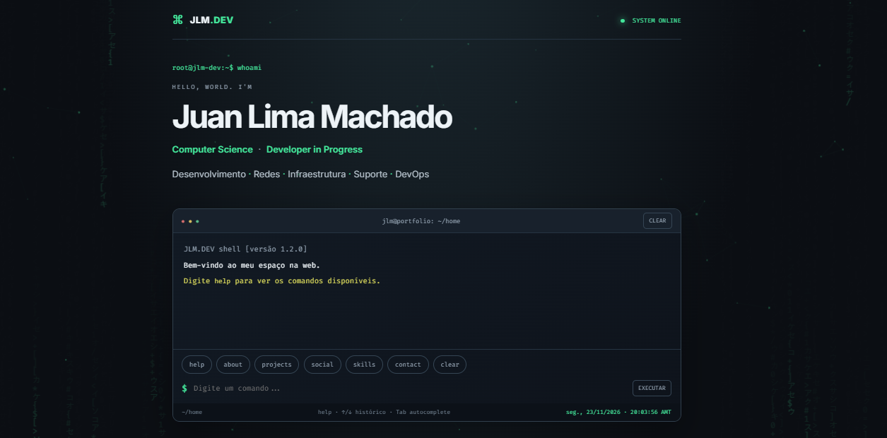

# JLM.DEV | Personal Developer Portfolio

**A personal space to showcase projects, technical knowledge and software development.**

Desenvolvido por **Juan Lima Machado**, estudante de Ciência da Computação, o JLM.DEV é um portfólio interativo criado para apresentar minha trajetória na tecnologia, meus conhecimentos e projetos desenvolvidos ao longo da minha formação.

Mais do que um portfólio convencional, o projeto utiliza uma interface inspirada em terminal, proporcionando uma experiência interativa na qual o visitante pode explorar informações por meio de comandos.

---

## Preview

<p align="center">
  
</p>

---

## About the Project

O JLM.DEV nasceu da proposta de desenvolver uma apresentação profissional que fosse além de uma página pessoal tradicional.

A interface combina uma estética minimalista com elementos inspirados em ambientes de desenvolvimento e terminais de sistemas operacionais.

O projeto busca apresentar não apenas quem sou, mas também como trabalho, quais tecnologias estudo e quais soluções desenvolvo.

### Main Objectives

- Apresentar conhecimentos e competências técnicas.
- Centralizar projetos e repositórios em um único ambiente.
- Explorar conceitos de desenvolvimento front-end e interatividade.
- Proporcionar uma experiência de navegação diferenciada.
- Construir uma identidade profissional na área de tecnologia.

---

## Technologies & Tools

| Tecnologia | Aplicação |
|---|---|
| HTML5 | Estruturação da interface |
| CSS3 | Estilização, layout, temas e animações |
| JavaScript | Interatividade, terminal e efeitos visuais |
| Git | Controle de versão |
| GitHub | Hospedagem e gerenciamento do código |

---

## Features

### Interactive Terminal
Interface inspirada em terminais de sistemas operacionais, com sequência de boot, histórico de comandos, autocomplete e atalhos.

### Command Navigation
Navegação por comandos para acessar informações, projetos, skills e contatos.

### Themes
Troca de tema de cores em tempo real (`theme green|cyan|purple|amber`).

### Visual Effects
Matrix rain nas laterais, rede de partículas, scanlines sutis e animações de entrada.

### Responsive Interface
Adaptação completa para diferentes tamanhos de tela e dispositivos touch.

---

## Available Commands

| Command | Description |
|---|---|
| `help` | Exibe todos os comandos disponíveis |
| `about` | Apresenta informações sobre mim |
| `projects` | Exibe projetos e link para o GitHub |
| `skills` | Tecnologias com barras de nível |
| `social` / `contact` | Links e informações de contato |
| `neofetch` | Informações do “sistema” estilo neofetch |
| `theme <cor>` | Muda o tema (green, cyan, purple, amber) |
| `matrix [on\|off\|boost]` | Controla o efeito matrix |
| `fortune` | Exibe uma citação aleatória |
| `whoami` / `ls` / `pwd` / `date` / `uptime` | Comandos clássicos de terminal |
| `history` / `version` / `echo` / `sudo` | Extras e easter eggs |
| `clear` | Limpa o terminal |

---

## Project Structure

```text
jlmzin.github.io/
├── assets/
│   ├── icons/
│   └── images/
├── css/
│   └── style.css
├── js/
│   ├── terminal.js
│   └── effects.js
├── favicon.svg
├── index.html
└── README.md
```

---

## Getting Started

### Prerequisites

- Git
- Navegador atualizado
- Visual Studio Code (opcional)

### Installation

```bash
git clone https://github.com/jlmzin/jlmzin.github.io.git
cd jlmzin.github.io
```

Abra o `index.html` no navegador ou use a extensão Live Server.

---

## Developer

**Juan Lima Machado**

Computer Science Student | Software Development | Technology

Tenho interesse em desenvolvimento de software, programação, infraestrutura, redes e automação.

Busco desenvolver soluções, aprofundar conhecimentos técnicos e construir projetos que contribuam para minha evolução profissional.

### Connect with me

- **GitHub:** [github.com/jlmzin](https://github.com/jlmzin)
- **LinkedIn:** [juan-lima-machado](https://www.linkedin.com/in/juan-lima-machado/)
- **Instagram:** [@jlm.rss](https://www.instagram.com/jlm.rss/)
- **E-mail:** [juanllimacont1@gmail.com](mailto:juanllimacont1@gmail.com)

---

## License

Este projeto é destinado à apresentação do meu portfólio pessoal e desenvolvimento profissional.

---

<sub>Designed and developed by Juan Lima Machado · JLM.DEV</sub>
